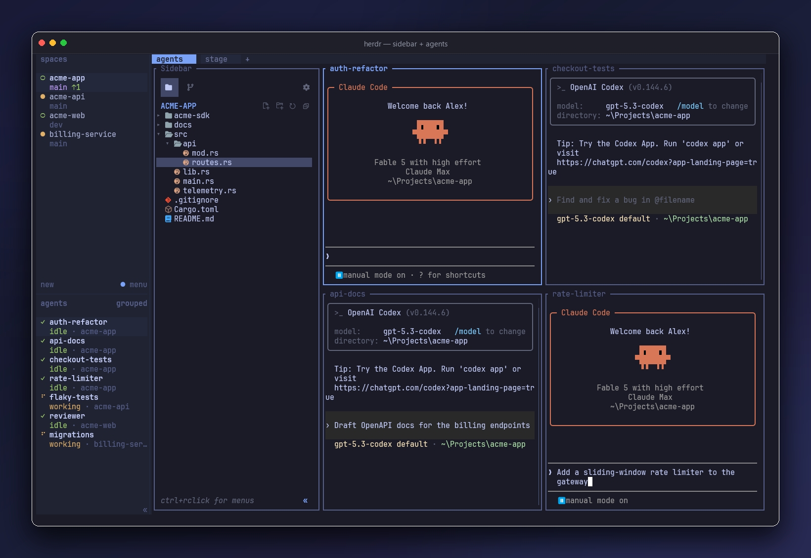

# herdr-sidebar

**The sidebar your terminal was missing** — a VS Code-inspired file explorer + source
control panel in one dockable herdr pane.



Based on [Alex Arthurs' herdr-sidebar](https://github.com/alexarthurs/herdr-sidebar),
with downstream project-directory-following fixes. The original sidebar,
screenshots, and scripts are copyright (c) 2026 Alex Arthurs, MIT licensed.
See [LICENSE](LICENSE) and [UPSTREAM.md](UPSTREAM.md).

The [upstream tour](https://github.com/alexarthurs/herdr-sidebar/blob/13ebde8d631494f1273d8c5e3503a755047c1267/README.md)
documents features, screenshots, keys, and settings.

## Install

Requires Herdr 0.8 or newer, Git, and Rust with a working native linker.
This downstream snapshot is source-built until matching release assets are
published in this repository. Installers never fetch upstream binaries, since
those would omit this repository's fixes.

```
herdr plugin install harshad22491/herdr-agentpanel/plugins/herdr-sidebar --yes
```

or from a local checkout:

```
cargo build --release
herdr plugin link .
```

In sidebar Settings, enable **Auto-open** and **Follow pane folder** once.
Thereafter, new spaces and working-directory changes are followed automatically.
On Windows this uses the directory reported by Herdr's shell integration;
an unintegrated shell cannot report directory changes. Git details come from the
selected folder's repository; a non-Git folder has no repository details.

The plugin ID stays `herdr-sidebar` so existing settings, saved folders, and
shortcuts continue to work. Use one installation of that ID, not both upstream
and downstream registrations. Keep the previous checkout for rollback.

Open it (or just focus a tab — the hook docks it):

```
herdr plugin action invoke herdr-sidebar.open-sidebar-windows   # windows
herdr plugin action invoke herdr-sidebar.open-sidebar           # linux / macos
```
